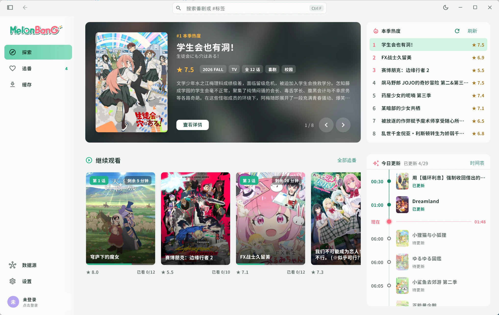
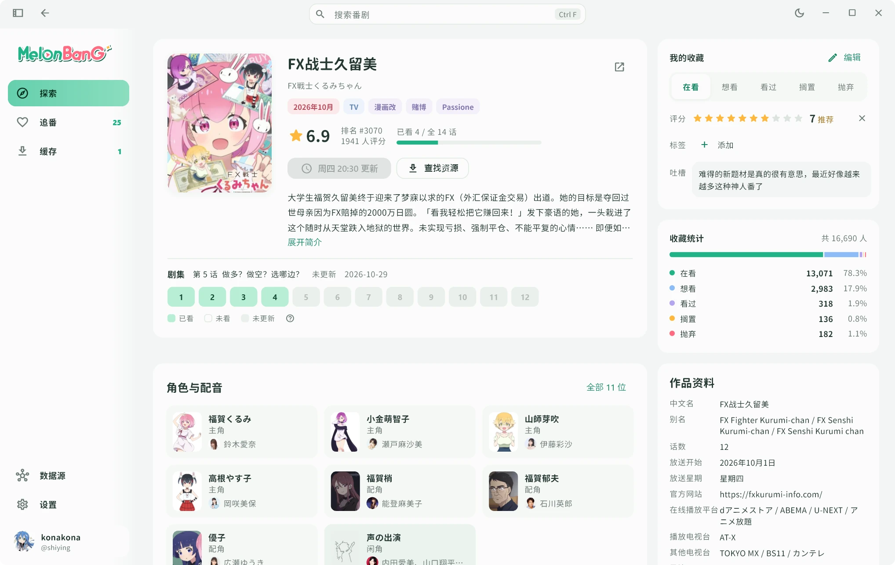
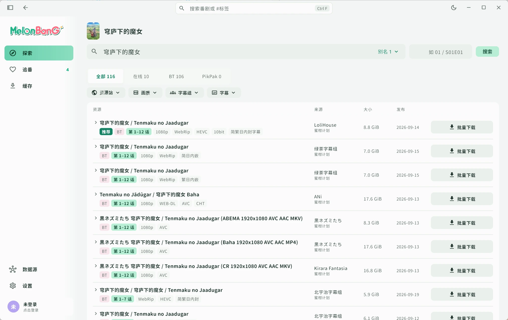
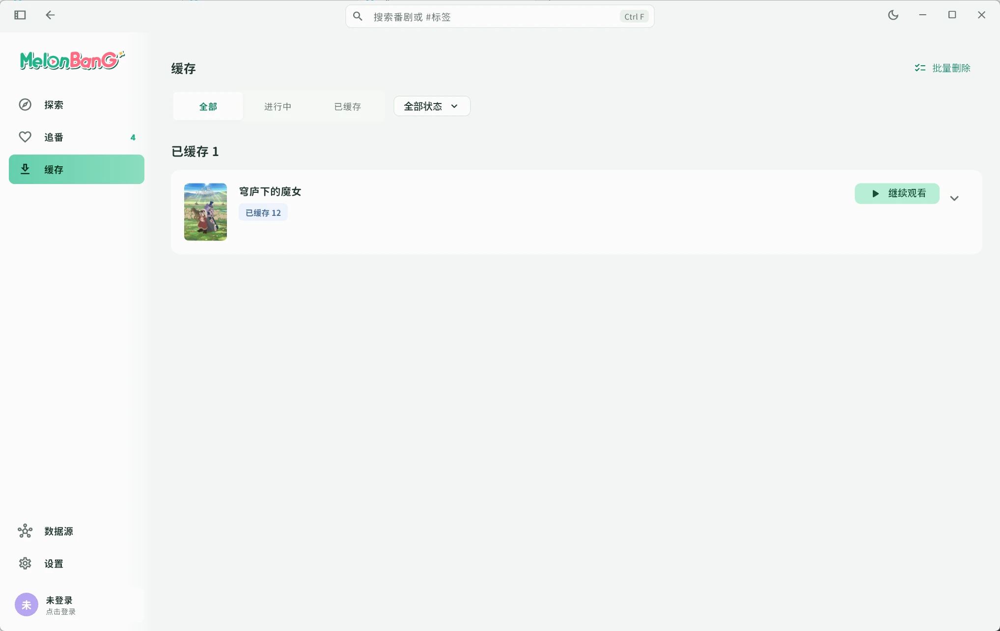
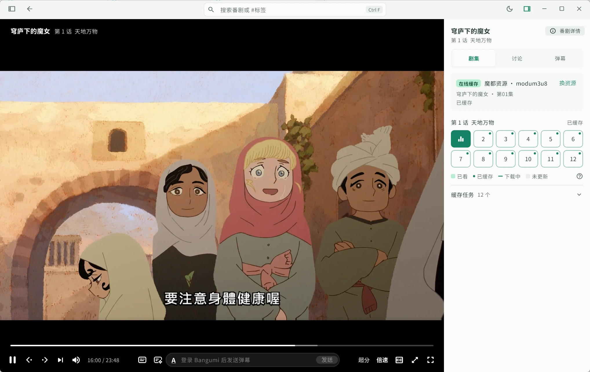

<div align="center">


<p><b>追番？轻而易举！一个桌面应用全搞定!</b></p>

> 一个原生桌面追番客户端。番剧信息和收藏来自 [Bangumi][bangumi]，资源来自在线源和 BT，自带缓存、播放器和弹幕，找番、下载、观看、记进度在一个应用里完成。

<p>
  <a href="https://github.com/shirumesu/MelonBanG/releases"></a>
  <a href="https://github.com/shirumesu/MelonBanG/releases"></a>
  
  <a href="LICENSE"></a>
  
</p>

<p>
  <a href="#下载">下载</a> ·
  <a href="#常见问题">常见问题</a> ·
  <a href="#从源码构建">从源码构建</a>
</p>

<picture>
  <source media="(prefers-color-scheme: dark)" srcset=".github/screenshots/home-dark.webp">
  
</picture>

</div>

<div align="center">

| 番剧详情 | 资源搜索 |
| :---: | :---: |
| 简介、剧集、收藏一屏看完，点一下就播 | 在线源、BT、本地缓存一次搜完，按字幕组和画质筛选 |
|  |  |
| **缓存** | **播放器** |
| BT 边下边播，支持 PikPak 云端加速 | mpv 内核，弹幕、Anime4K 超分、自动跳片头片尾 |
|  |  |

</div>

## 功能

- 本季热度、每周时间表、继续观看
- 登录 Bangumi 后双向同步收藏、评分和观看进度
- 资源合并搜索：在线源、BT（蜜柑计划、动漫花园）、PikPak
- 内置 BT 引擎，边下边播
- 弹幕：弹弹play、哔哩哔哩、巴哈姆特动画疯，以及 MelonBanG 自己的弹幕服务
- 硬件解码、ASS 字幕、倍速、Anime4K 实时超分
- 浅色 / 深色主题，可按番剧封面取色

## 下载

前往 [Releases](https://github.com/shirumesu/MelonBanG/releases) 下载最新版本，应用内会自动检查更新。

| 平台 | 要求 | 文件 |
| --- | --- | --- |
| Windows | Windows 10 / 11，x64 | `MelonBanG-<版本>-windows-x64-setup.exe`（安装版）<br>`MelonBanG-<版本>-windows-x64.zip`（便携版） |
| macOS | macOS 13 及以上，Apple 芯片 | `MelonBanG-<版本>-macos-arm64.dmg` |

> [!NOTE]
> 目前处于 alpha 阶段，可能会遇到问题，欢迎在 [Issues](https://github.com/shirumesu/MelonBanG/issues) 反馈。

<details>
<summary><b>macOS 提示「无法验证开发者」</b></summary>

安装包没有经过 Apple 公证，第一次打开会被拦下。把应用拖进「应用程序」后，在 **系统设置 → 隐私与安全性** 点 **仍要打开**，或在终端运行：

```sh
xattr -dr com.apple.quarantine /Applications/MelonBanG.app
```

更新后首次读取登录信息时如果弹出钥匙串授权，选 **始终允许**。

</details>

## 常见问题

<details>
<summary><b>视频资源是从哪里来的？</b></summary>

MelonBanG 本身不存储、不提供任何视频。资源来自公开的 BT 网络、种子索引站、在线视频网站，以及你自己的 PikPak 账号。

</details>

<details>
<summary><b>不登录 Bangumi 能用吗？</b></summary>

能。浏览、搜索、下载和播放都不需要登录；登录后才能同步收藏和发送弹幕。

</details>

<details>
<summary><b>BT 会上传吗？</b></summary>

默认会适量做种，达到分享率 1 或做种 60 分钟后停止。可以在 **设置 → 下载与做种** 里改成停止分享。

</details>

<details>
<summary><b>开着代理时 BT 没速度</b></summary>

TUN / 全局模式的代理可能让 BT 连不上 Tracker 和 DHT。给 MelonBanG 加一条直连规则即可，例如 Clash：

```yaml
- PROCESS-NAME,melonbang.exe,DIRECT
```

</details>

<details>
<summary><b>怎么卸载？</b></summary>

在 **设置 → 更新与关于** 里卸载，可以选择是否保留数据和缓存。

</details>

## 从源码构建

需要 Flutter 稳定版。Windows 需要 Visual Studio C++ 桌面开发组件，macOS 需要 Xcode 和 Homebrew。

```sh
git clone https://github.com/shirumesu/MelonBanG.git
cd MelonBanG
cp .env.service.example.json .env.service.json   # 可留空，留空时 Bangumi 登录和弹弹play 弹幕不可用
flutter pub get
flutter run -d windows   # 或 -d macos
```

## 致谢

- [Bangumi 番组计划][bangumi]、[弹弹play 开放平台][dandanplay]
- [media-kit](https://github.com/media-kit/media-kit) / [mpv](https://mpv.io)、[libtorrent](https://libtorrent.org)、[Anime4K][anime4k]
- [Resource Han Rounded](https://github.com/CyanoHao/Resource-Han-Rounded)、[Rclone](https://github.com/rclone/rclone)
- [Kazumi](https://github.com/Predidit/Kazumi)、[Animeko](https://github.com/open-ani/animeko)：同类优秀项目

第三方许可证见 [THIRD_PARTY.md](THIRD_PARTY.md)。

## 免责声明

本项目仅供学习交流，使用者需遵守所在地的法律法规。MelonBanG 不对通过它获取的任何内容负责，也不收集任何使用数据。

## 许可证

[GPL-3.0](LICENSE)

[bangumi]: https://bgm.tv
[dandanplay]: https://www.dandanplay.com
[anime4k]: https://github.com/bloc97/Anime4K
